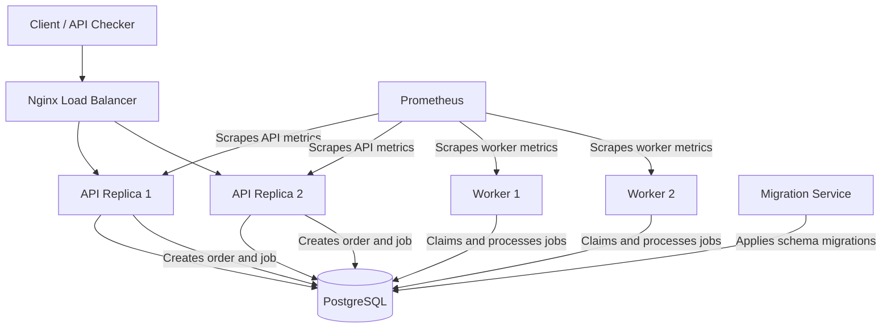

# FulfillOps Architecture

## 1. Overview

FulfillOps is an order-processing application built around a FastAPI API, PostgreSQL database, and background workers.

The API accepts and validates orders, reserves inventory, and records background jobs. Workers process those jobs independently of the API. PostgreSQL is the shared source of truth for orders, inventory, idempotency records, and job state.

Nginx provides the HTTP entry point and distributes requests across API replicas. Prometheus collects application and worker metrics.

## 2. Architecture Diagram

## 3. Main Components

### 3.1 Nginx

Nginx is the public HTTP entry point in the Docker Compose stack. It listens on the configured host port and distributes incoming API requests across the API replicas.

### 3.2 FastAPI application

The API is implemented in the `api/` package.

Main responsibilities include:

- Validating incoming requests.
- Returning catalogue and inventory information.
- Creating orders.
- Reserving inventory transactionally.
- Enforcing idempotency.
- Recording background jobs.
- Exposing health and metrics endpoints.

Main endpoints:

| Endpoint | Purpose |
|---|---|
| `GET /health/live` | Liveness check |
| `GET /health/ready` | Readiness check |
| `GET /api/v1/catalog` | Retrieve the product catalogue |
| `GET /api/v1/inventory/{sku}` | Retrieve available inventory |
| `POST /api/v1/orders` | Create an order |
| `GET /api/v1/orders/{order_id}` | Retrieve an order |
| `GET /metrics` | Expose API metrics |

The API code is separated into modules for database access, models, request schemas, order operations, and metrics.

### 3.3 PostgreSQL

PostgreSQL is the shared persistent data store.

The six core tables are:

- `products`
- `inventory`
- `orders`
- `order_items`
- `idempotency_keys`
- `jobs`

Database constraints, transactions, and row locking protect important business rules. The database is the source of truth shared by API replicas and workers.

The Compose stack uses a persistent volume for PostgreSQL data.

### 3.4 Background workers

The worker implementation is in the `worker/` package.

Workers operate independently of the API and retrieve jobs from PostgreSQL. The worker repository handles database operations, while the processor coordinates job processing.

The agreed worker contract includes:

- Atomic job claiming with PostgreSQL row locking and `SKIP LOCKED`.
- Time-limited leases and lease tokens.
- Lease renewal and recovery of expired claims.
- Bounded retries with backoff.
- Transactional order and inventory updates on completion.
- Keeping inventory reservations when an order fails, for operator review.

The Compose configuration runs two worker replicas.

### 3.5 Database migrations

Alembic manages database schema changes.

The initial migration creates the database schema and seeds the initial product catalogue and inventory. In Docker Compose, the migration service runs before the API services start.

Migrations are version-controlled and are not intended to run independently in every API replica.

### 3.6 Prometheus

Prometheus collects metrics from the API and worker services.

The API exposes its metrics through `/metrics`. Worker telemetry has a separate health and metrics listener.

Prometheus uses a persistent volume for its time-series data.

## 4. Order Processing Flow

1. A client sends an order request to the Nginx entry point.
2. Nginx forwards the request to an API replica.
3. The API validates the request and normalizes duplicate SKU lines.
4. The API checks the idempotency key.
5. The API locks the relevant inventory rows and checks available stock.
6. Within one database transaction, the API reserves stock and creates the order, order items, idempotency record, and background job.
7. The API returns `202 Accepted` after the transaction commits.
8. A worker claims the queued job from PostgreSQL.
9. The worker processes the job and updates the job, order, and inventory state transactionally.
10. The client can retrieve the order status through the order retrieval endpoint.

If order creation fails before commit, the transaction is rolled back so partial order data and reservations are not left behind.

## 5. Reliability and Consistency

The architecture uses PostgreSQL-backed coordination rather than process-local state for important business operations.

Key protections include:

- Idempotency records allow repeated requests to return the original order instead of creating duplicates.
- Database transactions keep order creation and stock reservation atomic.
- Inventory row locking protects against concurrent requests overselling stock.
- A unique job per order prevents multiple jobs from being created for the same order.
- Worker leases allow another worker to recover jobs after a worker crash.
- Lease tokens prevent an outdated worker claim from finalizing a job after ownership has changed.
- Bounded retries prevent a repeatedly failing job from being retried indefinitely.

## 6. Health and Observability

The API provides separate liveness and readiness endpoints.

- Liveness indicates whether the API process is alive.
- Readiness checks whether the API can use its required database state.

The worker exposes its own health and telemetry endpoints. Prometheus collects API and worker metrics, including HTTP request measurements and worker activity.

These signals support monitoring and help identify unhealthy application instances.

## 7. Container and Runtime Security

The Docker Compose application containers use several security restrictions:

- Read-only root filesystems for API, worker, and Prometheus containers.
- Temporary filesystems for `/tmp` where needed.
- Dropped Linux capabilities.
- `no-new-privileges` security options.
- Health checks for PostgreSQL, API, and worker services.
- A graceful worker stop period.

Database credentials are supplied through environment configuration rather than committed application source files.

## 8. Runtime Deployment

The project supports a local Docker Compose environment and a local Kubernetes environment.

Docker Compose defines PostgreSQL, a migration service, API replicas, worker replicas, Nginx, and Prometheus.

The Kubernetes manifests and GitOps configuration are documented separately in:

- `docs/kubernetes-local.md`
- `docs/kubernetes-manifests.md`
- `docs/gitops.md`
- `docs/environment.md`

The evidence index in `docs/evidence/README.md` identifies the recorded deployment, monitoring, rollout, and recovery demonstrations.

## 9. Related Documentation

- `docs/API_CONTRACT_EN.md` — API behaviour and endpoint contract.
- `docs/integration-contract.md` — database schema, transaction rules, and API/worker integration contract.
- `docs/ci-cd.md` — continuous integration and delivery.
- `docs/kubernetes-local.md` — local Kubernetes environment.
- `docs/kubernetes-manifests.md` — Kubernetes resources.
- `docs/gitops.md` — GitOps deployment and reconciliation.
- `docs/evidence/README.md` — evidence index.
