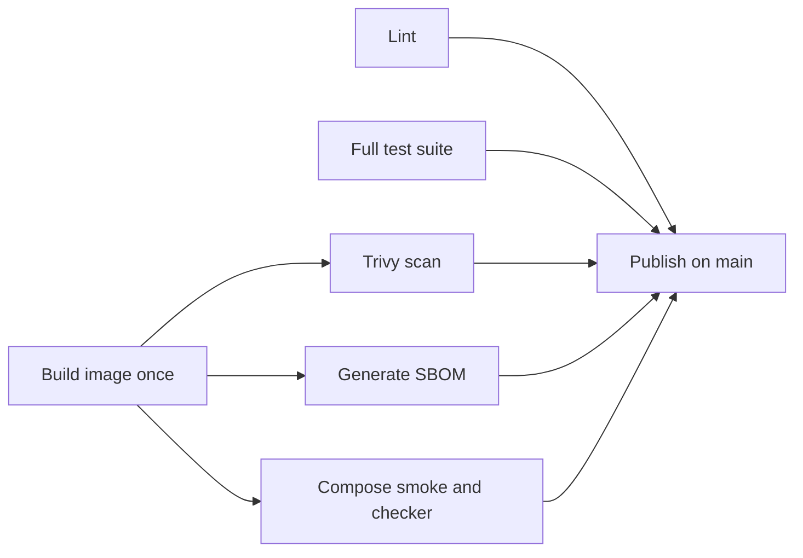

# CI and image publication

The workflow is `.github/workflows/ci.yml`. Pull requests targeting `main`, pushes to `main`,
and manual dispatches run the quality pipeline.

Lint checks the configured Python paths and every repository Dockerfile. The test job runs the
full API, worker, and integration suite against a disposable PostgreSQL service after applying
Alembic migrations; stub-only deployment tests are excluded. Build produces one `linux/amd64`
image archive; scan, SBOM, and contract jobs download and load that same archive, so their results
describe the image that can be published. The contract job starts the isolated Compose test
project and runs the public checker as a blocking check.

## Vulnerability policy

Trivy blocks the pipeline on fixable HIGH or CRITICAL findings (`ignore-unfixed: true`). Findings
without an available fix do not block because there is no actionable patch to apply yet; they are
still included in the informational report. A second scan reports all severities as JSON and a
table with exit code zero. `.trivyignore` is intentionally empty except for its policy header. Any
exception added there must identify a CVE, explain why it is accepted, and include an expiry date.
The Trivy database is cached across runs to reduce repeated downloads and rate-limit exposure.
No SARIF is uploaded to GitHub code scanning.

## Reproducibility and access

Every GitHub Action is referenced by a full commit SHA so a tag cannot silently move to different
code; the tag/version comment records which release was resolved. The image is built once and
passed between jobs as a seven-day artifact rather than rebuilt for each check. Workflow-wide
permissions are read-only; only the publish job receives `packages: write`, which it needs to push
to GHCR. Its image name lowercases the repository owner and uses the complete commit SHA as the
immutable tag. It records the published image, tag and registry digest in the job summary.

Artifacts are attached to each workflow run: `junit` contains test results, `trivy-reports`
contains the informational scan, `sbom` contains `sbom.cdx.json`, and `checker-output` contains the
public checker log. The publish run adds a `published-image-sbom` copy. The `fulfillops-image`
archive is an intermediate seven-day artifact used to ensure the later jobs inspect the exact same
build.

CI builds amd64. Local kind on Apple Silicon should use the locally built image for the Mac's
architecture. The current repository environment note is [docs/environment-person-C.md](environment-person-C.md).

## Branch protection setup

In GitHub repository **Settings → Branches → Add branch protection rule** for `main`:

- Require a pull request before merging.
- Require status checks: `lint`, `test`, `scan`, `sbom`, and `contract`.
- Disable force pushes.
- Keep direct pushes to `main` restricted according to the team's repository policy.

The `build` job is an input-producing job rather than a final quality gate; the listed downstream
checks each depend on it. Configure these rules in GitHub because workflow YAML cannot enforce
repository branch protection by itself.
